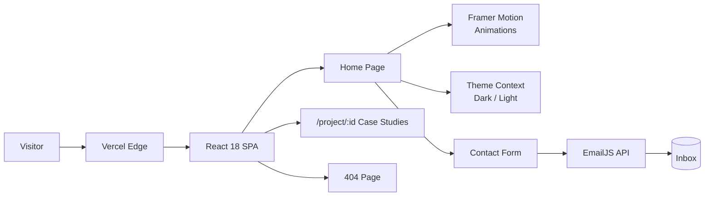

<div align="center">

# GOWTHAM K
 
### Creative Tech Editorial Portfolio
 
**Full Stack Developer · Software Engineer**
 
*“Build thoughtfully. Design beautifully. Engineer impact.”*
 
<br/>
[](https://gowtham-portfolio-peach.vercel.app/)
[](https://linkedin.com/in/gowtham-k-0577a131a)
[](mailto:gowtham.k2023it@sece.ac.in)
 


 
<br/>
<!-- Add a hero screenshot or GIF here:

-->
 
</div>
---
 
## 📖 Table of Contents
 
- [✨ About](#-about)
- [🎨 Design System](#-design-system)
- [🧩 Sections](#-sections)
- [🚀 Featured Projects](#-featured-projects)
- [🏗️ Architecture](#️-architecture)
- [🛠️ Tech Stack](#️-tech-stack)
- [💻 Getting Started](#-getting-started)
- [📁 Project Structure](#-project-structure)
- [🏆 Highlights](#-highlights)
- [📬 Contact](#-contact)
---
 
## ✨ About
 
A bespoke, production-ready developer portfolio with a **Creative Tech Editorial** aesthetic: magazine-style typography, a bold colour palette, cinematic motion, and dedicated **architectural case-study pages** for every flagship project.
 
> **Why it stands out:** four curated font families, scroll-driven animations, a live typing terminal in the hero, and deep-dive case studies instead of just project cards.
 
| | |
| :-- | :-- |
| 🎓 **Education** | B.Tech IT, Sri Eshwar College of Engineering (2023–2027) · CGPA 8.22 / 10 |
| 💼 **Experience** | MERN Stack & NextGen Data Engineering internships |
| 🏅 **Recognition** | NPTEL Elite HCI · Top 2% nationwide (99% score) |
| 🌐 **Live** | [gowtham-portfolio-peach.vercel.app](https://gowtham-portfolio-peach.vercel.app/) |
 
---
 
## 🎨 Design System
 
<table>
<tr>
<td width="50%" valign="top">
### Colour Palette
 
| Swatch | Name | Hex |
| :-: | :-- | :-- |
|  | Warm Ivory | `#F7F6F2` |
|  | Deep Charcoal | `#171717` |
|  | Electric Violet | `#7057F5` |
|  | Soft Lavender | `#B5A0FF` |
|  | Soft Lime | `#D9F86A` |
 
</td>
<td width="50%" valign="top">
### Typography
 
| Font | Role |
| :-- | :-- |
| **Space Grotesk** | Display headings & counters |
| ***Instrument Serif*** | Editorial italic accents |
| **Manrope** | Body & UI text |
| `JetBrains Mono` | Code, chips, metadata |
 
</td>
</tr>
</table>
---
 
## 🧩 Sections
 
| # | Section | What you get |
| :-: | :-- | :-- |
| 1 | 🧭 **Floating Capsule Nav** | Glassmorphic pill with sliding active indicator (`layoutId`), dark/light toggle, resume button, full-screen mobile menu |
| 2 | 🎬 **Editorial Hero** | Letter-by-letter title, live typing terminal (`developer.ts`), availability radar dot, animated stat counters |
| 3 | 👤 **About** | Narrative, education, engineering principles in bento cards |
| 4 | ⚙️ **Technical Arsenal** | Bento grid with interactive category tabs covering 32 technologies |
| 5 | 🚀 **Featured Projects** | Asymmetric layout: flagship **TrackZone** with simulated satellite geofence & biometric radar, plus **Rentaro** and **CivicTrack** |
| 6 | 📑 **Case Studies** | `/project/:id` pages with problem, solution, architecture, workflow, live demo and GitHub links |
| 7 | 🧳 **Experience** | Vertical timeline with progressive line-draw animation |
| 8 | 🏆 **Merit & Accolades** | NPTEL Elite HCI, Project Expo, National Debate, certifications |
| 9 | 📨 **Contact** | High-contrast charcoal section with a validated EmailJS form |
| 10 | 🔻 **Footer** | Monogram, quick links, back-to-top, brand tagline |
 
---
 
## 🚀 Featured Projects
 
<table>
<tr>
<td width="33%" valign="top">
### 📍 TrackZone
**Geofencing & Biometric Attendance**
 
GPS boundary verification with the Haversine algorithm, WebAuthn biometric security, RBAC and real-time analytics.
 
`React` `Node.js` `Express` `MongoDB` `JWT` `WebAuthn`
 
[🔗 Live Demo](https://trackzone-two.vercel.app/login) · [💻 Code](https://github.com/gowthamk2503/Trackzone)
 
</td>
<td width="33%" valign="top">
### 🚗 Rentaro
**Car Rental Management**
 
Real-time fleet availability, end-to-end booking, customer management and an admin dashboard with Google sign-in.
 
`React` `Node.js` `Express` `MongoDB` `REST` `OAuth 2.0`
 
[🔗 Live Demo](https://rentaromain.vercel.app/) · [💻 Code](https://github.com/gowthamk2503/Rentaro)
 
</td>
<td width="33%" valign="top">
### 🛣️ CivicTrack
**Road Maintenance & Citizen Feedback**
 
Photo uploads, geolocation tagging and a priority-based admin resolution dashboard on a multi-database setup.
 
`Python` `Flask` `Bootstrap` `MongoDB` `SQLite`
 
[💻 Code](https://github.com/gowthamk2503/CivicTrack)
 
</td>
</tr>
</table>
---
 
## 🏗️ Architecture
 

 
**Data-driven by design:** all content lives in `src/data/*.js`, so updating projects, skills, experience or achievements never requires touching a component.
 
---
 
## 🛠️ Tech Stack
 
| Layer | Tools |
| :-- | :-- |
| **Core** | React 18 · Vite · JavaScript (ESNext) |
| **Styling** | Tailwind CSS (custom editorial theme) · PostCSS · Autoprefixer |
| **Motion** | Framer Motion (scroll progress, staggered reveals, springs) |
| **Routing** | React Router v6 with SPA rewrite rules |
| **SEO** | React Helmet Async |
| **Icons** | Lucide React · custom SVG brand icons |
| **Email** | @emailjs/browser |
| **Hosting** | Vercel |
 
---
 
## 💻 Getting Started
 
```bash
# 1. Clone
git clone https://github.com/gowthamk2503/Portfolio.git
cd Portfolio
 
# 2. Install
npm install
 
# 3. Configure environment
cp .env.example .env
 
# 4. Run
npm run dev
```
 
Then open **http://localhost:3000**.
 
<details>
<summary><b>🔑 Environment variables (EmailJS)</b></summary>
<br/>
```env
VITE_EMAILJS_SERVICE_ID=your_service_id
VITE_EMAILJS_TEMPLATE_ID=your_template_id
VITE_EMAILJS_PUBLIC_KEY=your_public_key
```
 
</details>
<details>
<summary><b>📦 Production build</b></summary>
<br/>
```bash
npm run build
npm run preview
```
 
</details>
---
 
## 📁 Project Structure
 
<details>
<summary><b>Click to expand</b></summary>
<br/>
```
Portfolio/
├── public/
│   ├── favicon.svg             # GK monogram
│   └── resume.pdf              # Downloadable resume
├── src/
│   ├── components/
│   │   ├── Navbar.jsx          # Floating capsule nav
│   │   ├── Hero.jsx            # Terminal typing & counters
│   │   ├── About.jsx           # Narrative & bento cards
│   │   ├── Skills.jsx          # Category tabs & skill tiles
│   │   ├── Projects.jsx        # Flagship showcase
│   │   ├── Experience.jsx      # Progressive timeline
│   │   ├── Achievements.jsx    # Awards & certifications
│   │   ├── Contact.jsx         # EmailJS form
│   │   ├── Footer.jsx
│   │   ├── AnimatedSection.jsx # Framer Motion primitives
│   │   └── ScrollProgress.jsx  # Scroll depth bar
│   ├── data/                   # personalInfo · skills · projects · experience · achievements
│   ├── hooks/                  # useTheme · useScrollHooks
│   ├── pages/                  # Home · ProjectDetails · NotFound
│   └── utils/                  # skillIcons · socialIcons
├── tailwind.config.js
├── vite.config.js
├── vercel.json                 # SPA rewrites
└── ASSET_MANIFEST.md           # Image attribution
```
 
</details>
---
 
## 🏆 Highlights
 
- 🥇 **NPTEL Elite, Human Computer Interaction:** 99% score, top 2% among 23,139 candidates
- 🥈 **2nd Prize:** Project Expo
- 🥇 **1st Prize:** National Debate Competition
- 📜 **5 professional certifications**
---
 
## 📬 Contact
 
<div align="center">
**Have an idea? Let's build it.**
 
[](https://gowtham-portfolio-peach.vercel.app/)
[](https://linkedin.com/in/gowtham-k-0577a131a)
[](https://github.com/gowthamk2503)
[](mailto:gowtham.k2023it@sece.ac.in)
 
<br/>
⭐ *If this portfolio inspires you, consider starring the repo!*
 
</div>
 
