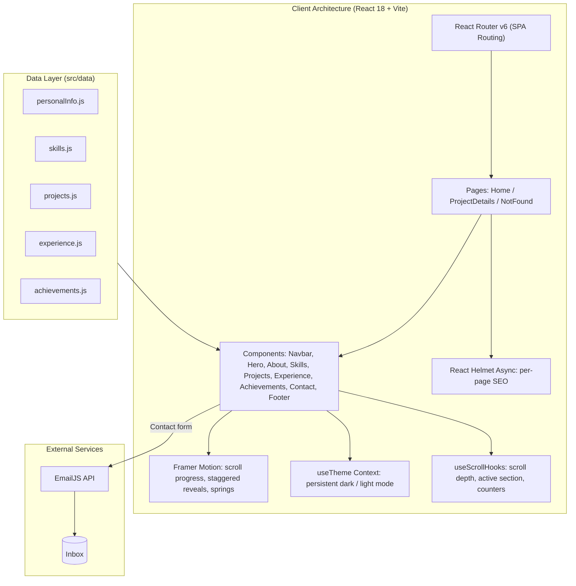
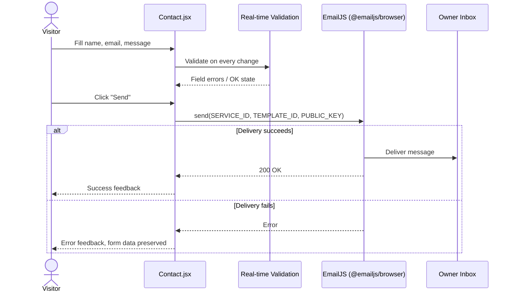
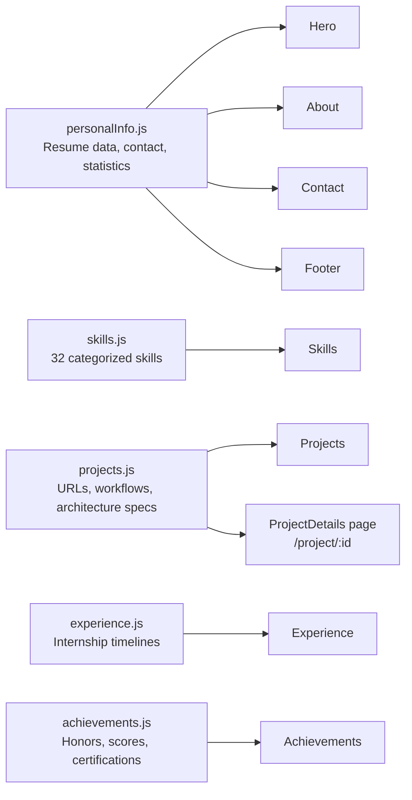
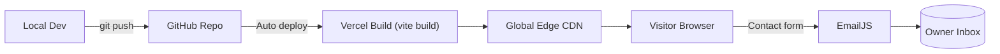

# 🎨 Gowtham K — Creative Tech Editorial Portfolio
### Full Stack Developer & Software Engineer

<p align="center">
  
  
  
  
  
</p>

<p align="center">
  
  
  
  
  
</p>

<p align="center">
  <a href="https://gowtham-portfolio-peach.vercel.app/"><b>🌐 Live Site</b></a> ·
  <a href="https://github.com/gowthamk2503/Portfolio"><b>💻 Source Code</b></a> ·
  <a href="https://linkedin.com/in/gowtham-k-0577a131a"><b>🔗 LinkedIn</b></a> ·
  <a href="mailto:gowtham.k2023it@sece.ac.in"><b>✉️ Email</b></a>
</p>

<p align="center">
  A bespoke, production-ready developer portfolio built with a <b>Creative Tech Editorial</b> aesthetic: <b>four curated font families</b>, a bold ivory / charcoal / violet / lime palette, <b>scroll-driven Framer Motion animations</b>, and dedicated <b>architectural case-study pages</b> for every flagship project.
</p>

<p align="center"><i>"Build thoughtfully. Design beautifully. Engineer impact."</i></p>

---

## 📑 Table of Contents

- [System Architecture](#-system-architecture)
- [Key Features](#-key-features)
- [Design System](#-design-system)
- [Featured Projects](#-featured-projects)
- [Tech Stack](#-tech-stack)
- [Content Data Model](#-content-data-model)
- [Routing Map](#-routing-map)
- [Quick Start](#-quick-start--setup)
- [Environment Variables](#-environment-variables)
- [Available Scripts](#-available-scripts)
- [Project Structure](#-project-structure)
- [Deployment](#-deployment)
- [Performance & SEO](#-performance--seo)
- [Roadmap](#-roadmap)
- [Contributing](#-contributing)
- [License](#-license)
- [Author](#-author)

---

## 🏛️ System Architecture



### Request Lifecycle (Contact Form Flow)



---

## 🚀 Key Features

### 🧭 Navigation & First Impression
- **Floating Capsule Navigation**: glassmorphic pill with a sliding active-section indicator (`layoutId`), dark/light theme toggle, direct resume trigger, and a full-screen mobile menu.
- **Editorial Hero**: letter-by-letter animated title, a live typing developer terminal (`developer.ts`), an availability radar dot, and animated statistic counters.
- **Scroll Progress Bar**: top gradient bar that tracks scroll depth.

### 📚 Content Sections
- **About Me**: background narrative, B.Tech IT at Sri Eshwar College of Engineering (2023–2027), CGPA 8.22 / 10, and engineering principles in bento cards.
- **Technical Arsenal**: bento grid with interactive category tabs (Frontend, Backend, Databases, Languages, Tools, Data & Cloud) spanning **32 technologies**.
- **Featured Projects**: asymmetric showcase with a flagship **TrackZone** presentation (simulated satellite geofence and biometric radar), followed by dual bento cards for **Rentaro** and **CivicTrack**.
- **Case Study Deep-Dives**: dedicated `/project/:id` pages covering Problem Statement, Solution, System Architecture, Workflow, and direct Live Demo / GitHub buttons.
- **Work Experience**: vertical timeline with a progressive line-draw animation for the MERN Stack and NextGen Data Engineering internships.
- **Merit & Accolades**: NPTEL Elite HCI, Project Expo, National Debate, and certifications.

### 📨 Conversion & Polish
- **High-Contrast Contact**: deep charcoal section (`#171717`) with *"HAVE AN IDEA? LET'S BUILD IT."*, direct coordinates, and a functional EmailJS form with real-time validation.
- **Persistent Theming**: light/dark preference stored and restored across visits.
- **Footer**: monogram branding, quick links, back-to-top button, and brand tagline.
- **Custom 404 Page**: on-brand fallback for unknown routes.

---

## 🎨 Design System

<table>
<tr>
<td width="50%" valign="top">

### Colour Palette

| Swatch | Name | Hex | Role |
|:-:|---|---|---|
|  | Warm Ivory | `#F7F6F2` | Editorial canvas |
|  | Deep Charcoal | `#171717` | Text and dark sections |
|  | Electric Violet | `#7057F5` | Primary accent |
|  | Soft Lavender | `#B5A0FF` | Secondary accents, borders |
|  | Soft Lime | `#D9F86A` | High-impact highlights |

</td>
<td width="50%" valign="top">

### Typography Architecture

| Font | Role |
|---|---|
| **Space Grotesk** | Display headings, hero titles, counters |
| ***Instrument Serif*** | Editorial italic accents |
| **Manrope** | Body copy and UI text |
| `JetBrains Mono` | Code blocks, tech chips, metadata |

</td>
</tr>
</table>

---

## 🧩 Featured Projects

| Project | Description | Stack | Links |
|---|---|---|---|
| **📍 TrackZone** | Geofencing & biometric attendance with GPS boundary verification (Haversine), WebAuthn biometric security, RBAC and real-time analytics | React.js, Node.js, Express.js, MongoDB, JWT, WebAuthn | [Live](https://trackzone-two.vercel.app/login) · [Code](https://github.com/gowthamk2503/Trackzone) |
| **🚗 Rentaro** | Car rental management with real-time fleet availability, end-to-end booking, customer management and an admin fleet dashboard | React.js, Node.js, Express.js, MongoDB, REST APIs, Google OAuth 2.0 | [Live](https://rentaromain.vercel.app/) · [Code](https://github.com/gowthamk2503/Rentaro) |
| **🛣️ CivicTrack** | Road maintenance and citizen feedback with photo uploads, geolocation tagging and an admin priority-resolution dashboard | Python, Flask, HTML, CSS, JavaScript, Bootstrap, MongoDB, SQLite | [Code](https://github.com/gowthamk2503/CivicTrack) |

---

## 🧰 Tech Stack

| Layer | Technology |
|---|---|
| **Frontend Core** | React 18, Vite 8, JavaScript (ESNext) |
| **Styling** | Tailwind CSS (custom extended editorial theme), PostCSS, Autoprefixer |
| **Motion & Animation** | Framer Motion (scroll progress, staggered reveals, spring transitions) |
| **Icons** | Lucide React + custom SVG brand icons |
| **Routing** | React Router v6 (client-side routing with SPA rewrite rules) |
| **SEO & Head** | React Helmet Async |
| **Contact Service** | @emailjs/browser |
| **Deployment & Hosting** | Vercel |

---

## 🗄️ Content Data Model

All portfolio content is **data-driven**: editing a file in `src/data/` updates the site without touching any component.



---

## 🧭 Routing Map

| Route | Page | Purpose |
|---|---|---|
| `/` | `Home.jsx` | Single-page layout with all sections |
| `/project/:id` | `ProjectDetails.jsx` | Full architectural case study per project |
| `*` | `NotFound.jsx` | Custom 404 error page |

> `vercel.json` contains SPA rewrite rules so deep links like `/project/trackzone` resolve correctly in production.

---

## ⚡ Quick Start & Setup

### Prerequisites

| Requirement | Version |
|---|---|
| Node.js | v18+ (v20+ recommended) |
| npm | v9+ |
| EmailJS account | For the contact form (free tier works) |

### 1. Clone & Install

```bash
git clone https://github.com/gowthamk2503/Portfolio.git
cd Portfolio
npm install
```

### 2. Configure Environment

```bash
cp .env.example .env
```

See [Environment Variables](#-environment-variables) below.

### 3. Run in Development

```bash
npm run dev
# → http://localhost:3000
```

### 4. Build for Production

```bash
npm run build
npm run preview
```

---

## 🔐 Environment Variables

`.env`

```env
VITE_EMAILJS_SERVICE_ID=your_service_id
VITE_EMAILJS_TEMPLATE_ID=your_template_id
VITE_EMAILJS_PUBLIC_KEY=your_public_key
```

> ⚠️ **Never commit your `.env` file.** For deployment, add these three variables in your Vercel project settings (Settings → Environment Variables).

---

## 🛠️ Available Scripts

| Command | Description |
|---|---|
| `npm run dev` | Start the Vite dev server with hot reload |
| `npm run build` | Create an optimized production build |
| `npm run preview` | Serve the production build locally |

---

## 📁 Project Structure

```
Portfolio/
├── public/
│   ├── favicon.svg             # Custom geometric GK monogram logo
│   └── resume.pdf              # Target PDF for resume download
├── src/
│   ├── components/
│   │   ├── Navbar.jsx          # Floating capsule nav with animated active pill
│   │   ├── Hero.jsx            # Editorial hero with terminal typing & counter stats
│   │   ├── About.jsx           # Background narrative & bento info cards
│   │   ├── Skills.jsx          # Category tabs & bento skill tiles
│   │   ├── Projects.jsx        # Asymmetric flagship case-study showcase
│   │   ├── Experience.jsx      # Progressive draw-line vertical timeline
│   │   ├── Achievements.jsx    # NPTEL Elite HCI & competition awards
│   │   ├── Contact.jsx         # Deep charcoal contact form (EmailJS)
│   │   ├── Footer.jsx          # Editorial footer with brand tagline
│   │   ├── AnimatedSection.jsx # Reusable Framer Motion animation primitives
│   │   └── ScrollProgress.jsx  # Top linear gradient scroll depth bar
│   ├── data/
│   │   ├── personalInfo.js     # Resume data, contact, statistics
│   │   ├── skills.js           # 32 categorized technical skills
│   │   ├── projects.js         # Verified URLs, workflows, architecture specs
│   │   ├── experience.js       # Internship timelines and bullet points
│   │   └── achievements.js     # Honors, test scores, certifications
│   ├── hooks/
│   │   ├── useTheme.jsx        # Persistent light/dark mode context
│   │   └── useScrollHooks.js   # Scroll depth, active section, counter hooks
│   ├── pages/
│   │   ├── Home.jsx            # Single-page layout
│   │   ├── ProjectDetails.jsx  # Full architectural case study page
│   │   └── NotFound.jsx        # Custom 404 error page
│   └── utils/
│       ├── skillIcons.js       # Color & emoji mapping helper
│       └── socialIcons.jsx     # Custom SVG brand icons (GitHub, LinkedIn)
├── tailwind.config.js          # Warm ivory, electric violet, soft lime palette
├── vite.config.js              # Vite build & chunk configuration
├── vercel.json                 # SPA rewrite rules for production
├── ASSET_MANIFEST.md           # Visual research & Unsplash image attribution
└── README.md                   # Project documentation
```

---

## ☁️ Deployment

The site is hosted on **Vercel** with automatic deployments on every push to the main branch.



**Deploy your own copy**

1. Fork this repository.
2. Import it into [Vercel](https://vercel.com/new).
3. Add the three `VITE_EMAILJS_*` environment variables.
4. Deploy. `vercel.json` already handles SPA rewrites.

---

## 📈 Performance & SEO

- **Chunked builds**: Vite chunk configuration in `vite.config.js` keeps bundles lean.
- **Per-page metadata**: React Helmet Async sets titles and descriptions for the home and case-study pages.
- **Responsive by default**: mobile-first Tailwind layouts with a dedicated full-screen mobile menu.
- **Motion with purpose**: scroll-triggered reveals via reusable `AnimatedSection` primitives.
- **Attribution**: image sources are documented in [`ASSET_MANIFEST.md`](./ASSET_MANIFEST.md).

---

## 🗺️ Roadmap

- [ ] Add a blog / writing section
- [ ] Add a case study for every project (currently TrackZone, Rentaro, CivicTrack)
- [ ] Add multilingual support
- [ ] Add Lighthouse CI to the deployment pipeline
- [ ] Add a visitor-facing "Now" page for current work and learning

---

## 🤝 Contributing

This is a personal portfolio, but suggestions and bug reports are welcome.

1. Fork the repository
2. Create a feature branch: `git checkout -b feature/your-feature`
3. Commit using [Conventional Commits](https://www.conventionalcommits.org/): `fix: correct mobile menu overflow`
4. Push and open a Pull Request against `main`
5. Make sure `npm run build` succeeds before submitting

> Please do not reuse personal content (name, projects, photos, résumé data) from this repository. The code structure is free to learn from.

---

## 📄 License

Distributed under the **MIT License**. See [`LICENSE`](./LICENSE) for details. Personal content and branding remain © Gowtham K.

---

## 👤 Author

**Gowtham K**, Full Stack Developer & Software Engineer
B.Tech IT, Sri Eshwar College of Engineering (2023–2027)

| | |
|---|---|
| 🌐 **Portfolio** | [gowtham-portfolio-peach.vercel.app](https://gowtham-portfolio-peach.vercel.app/) |
| 💼 **LinkedIn** | [linkedin.com/in/gowtham-k-0577a131a](https://linkedin.com/in/gowtham-k-0577a131a) |
| 🐙 **GitHub** | [github.com/gowthamk2503](https://github.com/gowthamk2503) |
| ✉️ **Email** | [gowtham.k2023it@sece.ac.in](mailto:gowtham.k2023it@sece.ac.in) |

---

<p align="center">Built with ❤️ using React, Tailwind and a lot of coffee. If this portfolio inspires you, feel free to ⭐ the repo!</p>
